# 画面ごとの説明

このガイドではpiepの <!--stat:screens.count-->10<!--/stat--> 画面を紹介します。左のナビゲーションから行き来できます。

::: tip 掲載している絵について
すべてデモデータです。作品名・作者名・本文・統計はこのリポジトリに含まれる架空の
サンプル（`src/mocks/demoData.ts`）で、実在の作品や利用者のライブラリではありません。
:::

## ホーム
<!--screen:home-->

保存件数、使用容量、保存の推移、検索インデックスの状態がひと目で分かります。
URL を貼れば、そのまま保存候補へ進めます。

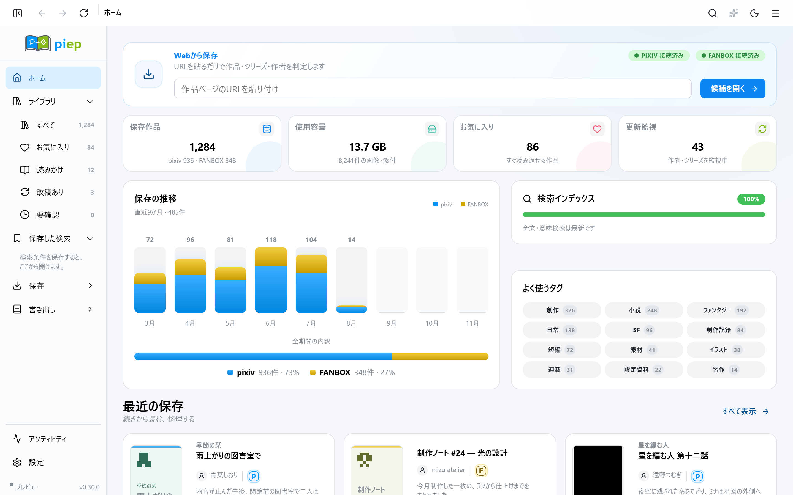

## ライブラリ
<!--screen:library-->

作品・作者・シリーズ・コレクションの四つの見方を切り替えられます。「すべて」
「お気に入り」「読みかけ」「改稿あり」「要確認」の棚、絞り込み、並べ替え、保存した検索、
ギャラリー／リスト表示、複数選択の一括操作。

検索欄の虫眼鏡から「標準検索」「キーワード検索」「意味検索」を切り替えられます。
関連語へ広げたくないときは「キーワード検索」を選びます。Enterは入力語の検索を保ち、候補の
作者や作品へは、クリックまたは矢印で選んでから移動します。作品URLや `id:番号` でも探せます。

絞り込みは左の項目から選び、「保存状態」では選択肢を直接押して指定します。
要確認の内訳、未保存の改稿、保存済みの改稿、
読みかけなどに加え、作者・タグ・シリーズ・日付・文字数・画像や添付・容量を組み合わせられます。
選択中の条件は適用前にも確認・解除でき、アドレスと「保存した検索」に残ります。
「改稿あり」も同じ条件表示から解除できます。不足情報の補完だけで増えた保存履歴は、
作品ページの履歴には残りますが、「改稿あり」には含めません。

上部の検索アイコン（Ctrl K）はライブラリ全体の検索と、画面・操作の検索を切り替えます。
作品を探すときは候補から直接開くか、検索結果の一覧へ進めます。取得元・作者・日付・文字数を
候補の同じ行で確認できます。検索方法と過去版の指定は、ここでも虫眼鏡から変更できます。

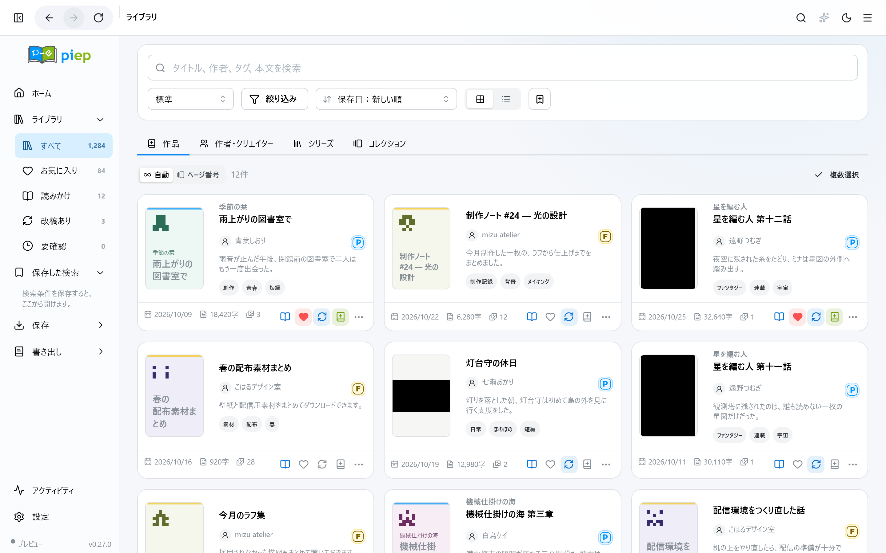

ダークテーマでも同じ形で出ます。

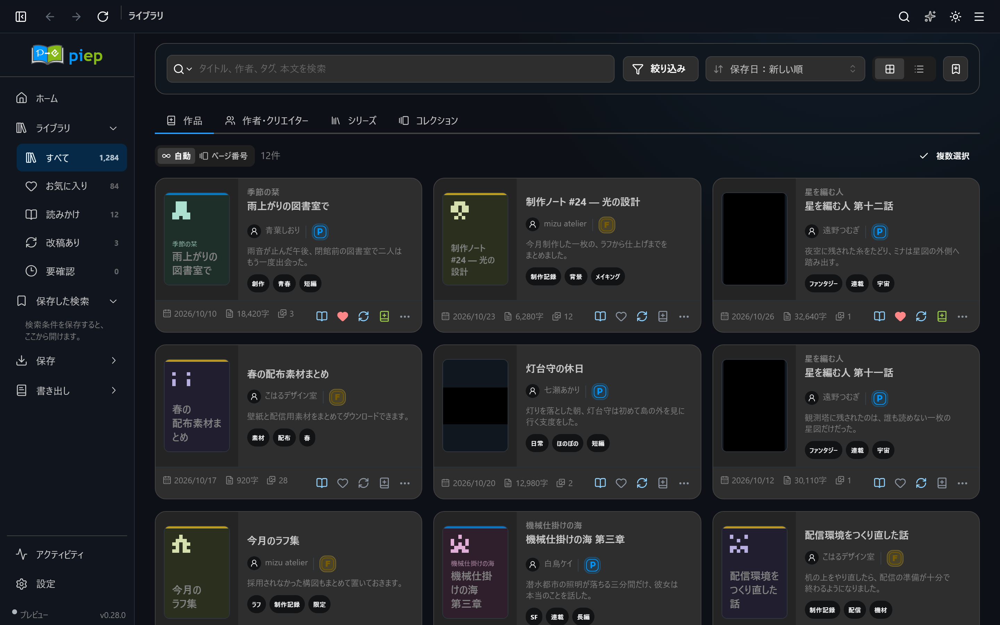

## 作者とクリエイター
<!--screen:library-people-->

保存した作品を、書いた人ごとにまとめて見る棚です。新作の監視もここから設定します。

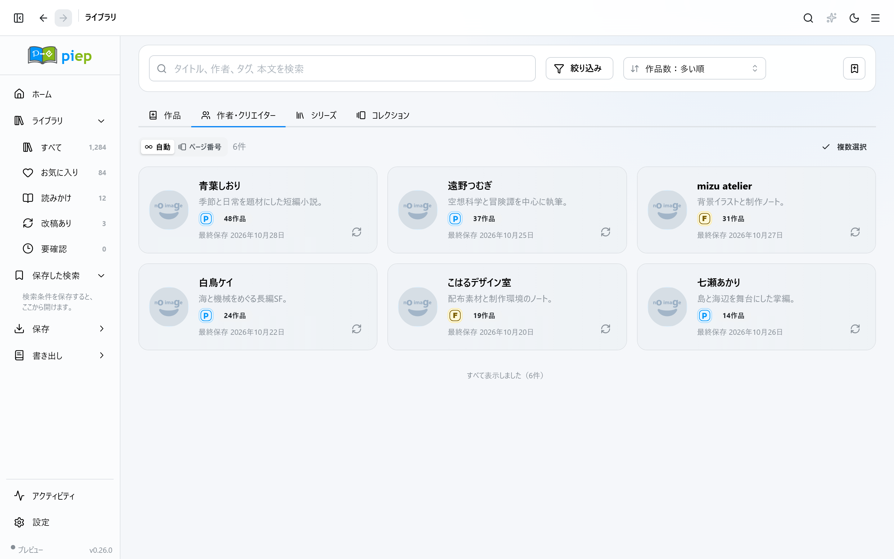

## 作品ページ
<!--screen:work-->

概要・本文・画像と添付・履歴・保存データを確認できます。そのまま読む、編集する、EPUB
キューに入れる、アーカイブとして書き出す、のいずれにも進めます。

画像・添付は現在の保存版から表示します。以前の版は一覧の右上で選べます。
要確認の作品では「取得状態」の「理由と本文の位置」から、欠けた画像の前後の文章と
本文の該当箇所を確認できます。隣のアイコンで参照先の画像をアプリ内に開けます。
取得元の本文にある画像の指定ミスは、取得先を閲覧できない場合と区別して表示します。
画面上部の更新アイコン（F5）は、入力内容や実行中の作業を保ったまま表示データを読み直します。

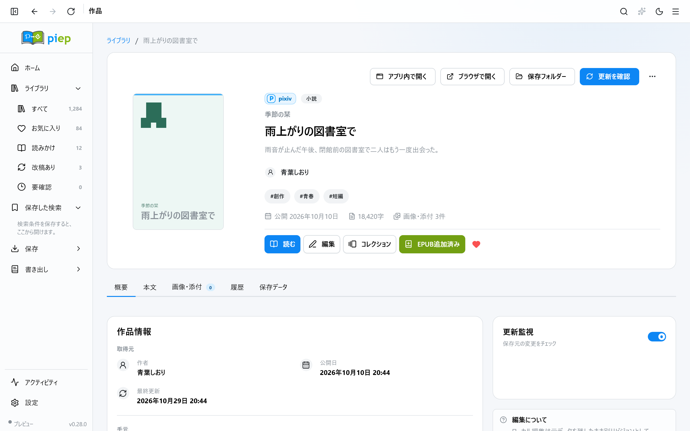

## リーダー
<!--screen:reader-->

縦書き／横書き、明朝／ゴシック、文字サイズ、行間、背景色を選べます。目次、しおり、
本文内検索（かな・カナ・全角半角の違いを吸収し、見つけた箇所に印を付けて移動）、
キーボードでのページ送り。

読みかけの位置は行単位で覚えるので、文字の大きさを変えてもずれません。

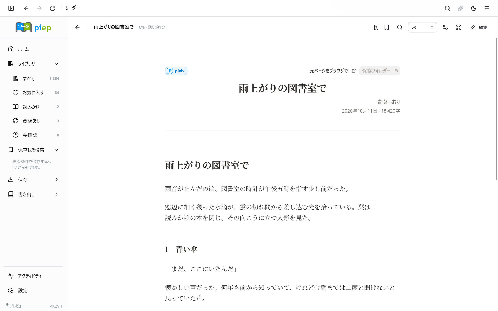

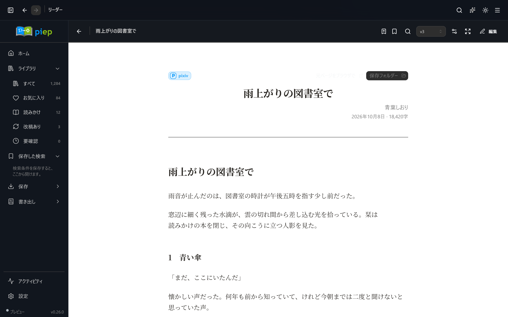

## エディタ
<!--screen:editor-->

見出しや段落をブロックとして掴んで並べ替え・書き換えでき、右側で仕上がりを確認
しながら下書きを保存できます。取り消しとやり直し、全文の置換、自動保存。

編集した本文は、挿絵も改ページも章も保ったまま EPUB へ書き出せます。元データは
そのまま残ります。

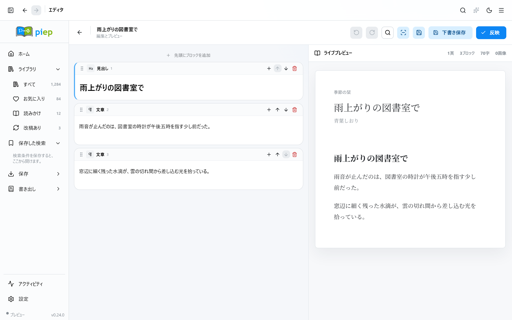

## 更新センター
<!--screen:updates-->

「確認のみ」と「自動保存」を選び、同時実行数を決めて実行します。進行中のジョブは
一時停止・再開・中止でき、失敗した分だけを後から再試行できます。

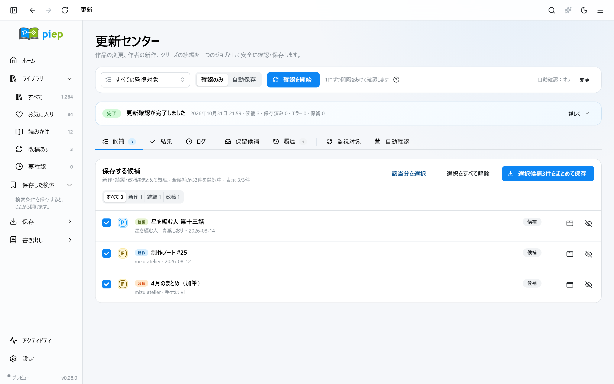

## EPUB Studio
<!--screen:epub-->

キューに入れた作品を、テンプレートと画像最適化の設定でまとめて書き出します。

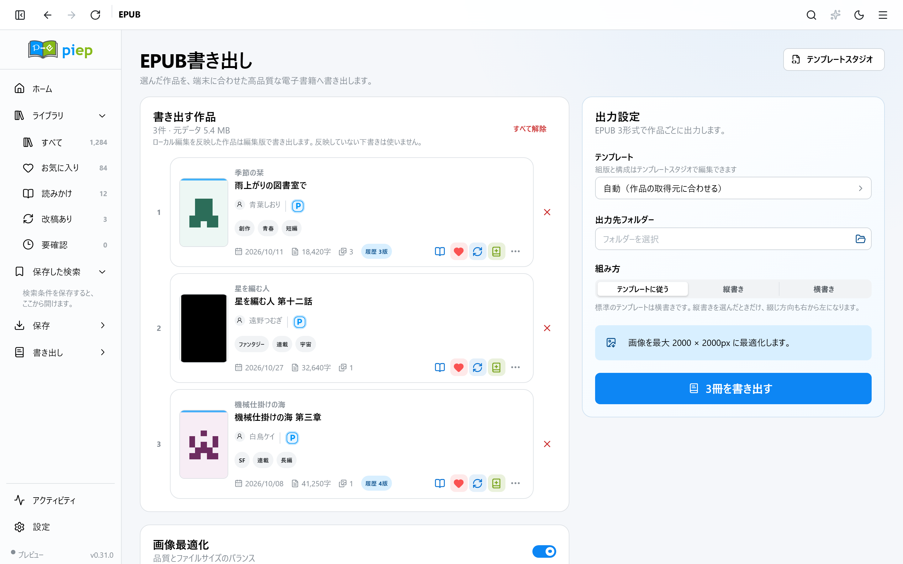

## 診断とメンテナンス
<!--screen:diagnostics-->

「診断する」で保存ファイルと登録情報を照合します。修復が必要な作者・シリーズ情報は
進捗と残件を確認できます。容量や検索時間は「詳細」、DB・検索索引の整理は「最適化と復元」
から開きます。未登録ファイルは未使用とは限らず、表示される容量は削除で空く量ではありません。

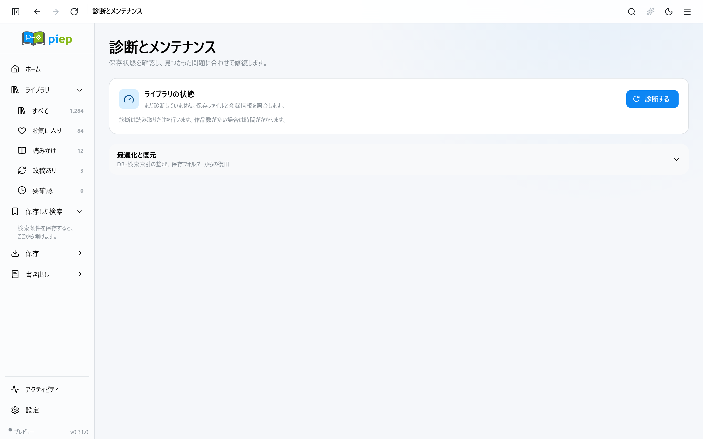

## 設定
<!--screen:settings-->

「保存する」「使いやすくする」「管理する」の目的別に項目をまとめています。
設定項目の検索では「復元」「テーマ」などの言葉から探せます。項目間の移動は戻る・進むでも辿れます。

表示と操作では、テーマ、サイドバー、一覧の表示と読み込み方を調整します。
一覧ごとの細かな指定は詳細を開いて変更できます。検索の設定ではいつもの検索方法を選び、
検索データの作り直しやモデルの状態は「検索データの保守」を開いて確認します。

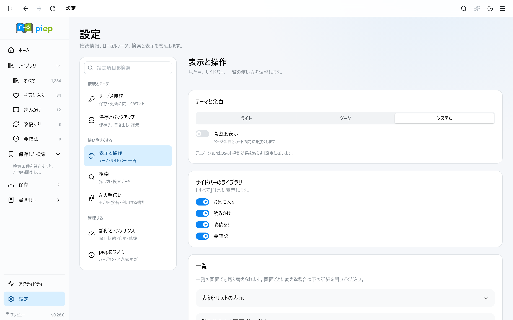

---

この頁の画面と、実際に撮っている画面が食い違うと CI が落ちます。突き合わせて
いるのは `e2e/readme-shots.spec.ts` の `shots` 表です。
