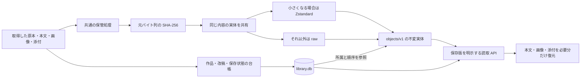
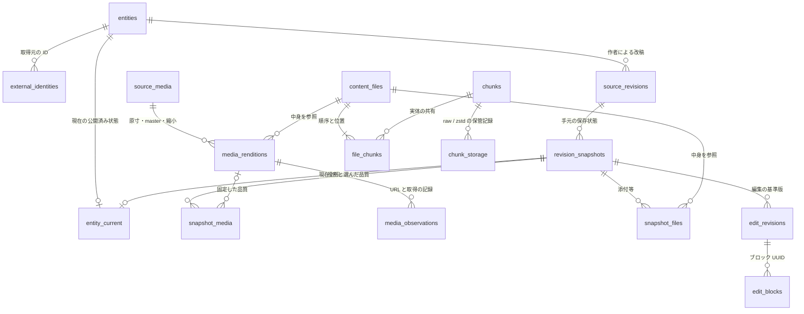
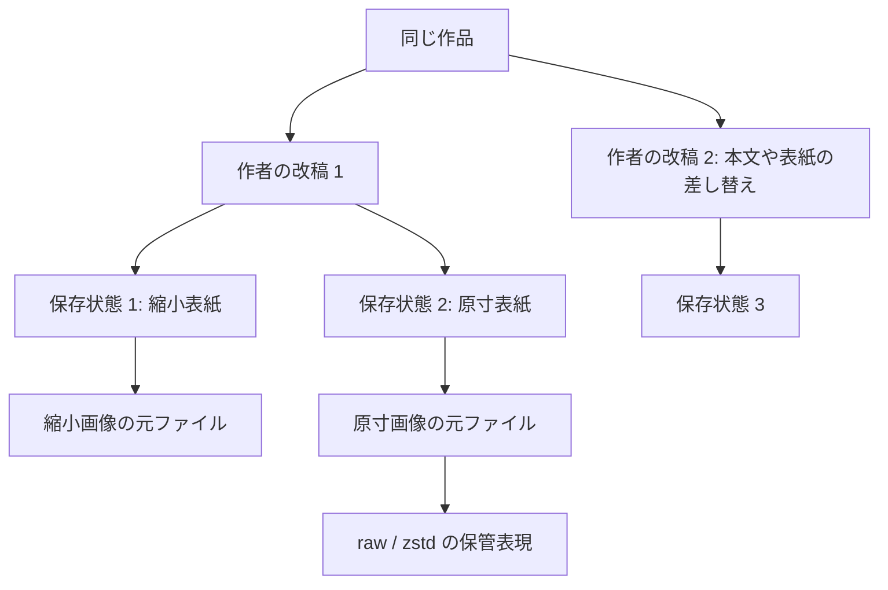
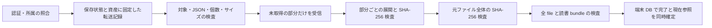

# 新ライブラリの構成を図で読む

対象: 開発中の新ライブラリ基盤。現行アプリの棚が自動変換された状態ではない。
詳細な規則は [データモデル](library-data-model.md)、[可逆保管](library-lossless-storage.md)、
[Android の境界](android-library-v2.md) を正本とする。

## まず全体像



DB は「何を、どの作品・版のものとして読むか」を管理する。実体は内容のハッシュで
保管するため、同じ画像を別の作品や保存版が参照しても、中身を作品ごとに複製しない。
元ファイルを復元した長さと SHA-256 が一致することを検査する。
画像の画素だけでなく、EXIF・ICC・透過・アニメーションも元バイト列のまま扱う。

## 保存フォルダ

### 新ライブラリの管理領域

```text
選んだ新ライブラリのルート/
├─ library.json                  棚 UUID と形式の印
├─ library.db                    作品・全保存状態・参照・利用者の記録
├─ library.db-wal / -shm          SQLite が利用中に作る補助ファイル
├─ .library.lock                 同時に開く処理を制御する錠
└─ objects/
   └─ v1/                        保管形式の版
      └─ ab/                     SHA-256 の先頭 2 文字で分散
         ├─ ab…64文字….obj       ヘッダー + raw / Zstandard の実体
         └─ ab…64文字….UUID.part 保存途中だけの一時ファイル
```

作品名・元ファイル名・取得 URL・画像の役割は DB に保持する。
実体の名前は変更しなくてよく、作品名の変更や同じ画像の共有にも対応できる。
このフォルダへ画像を直接追加する代わりに、保管 API で検証してから DB の参照を確定する。
検索索引・表示用キャッシュは再生成できる派生物として分け、新基盤との接続を進める。
SQLite は稼働中には通常の形式で使い、独自の圧縮 VFS は初版に入れない。
バックアップ用に採取した整合した DB ファイルは、元バイト列を保つ保管の対象にできる。

### Android の新しい実体領域

```text
アプリ専用の永続領域/
└─ library-v2/
   └─ 接続登録 UUID/
      └─ 棚 UUID/
         └─ 認証された利用者 UUID/
            └─ objects/v1/ab/ab…64文字….obj
```

利用者 UUID は端末 ID と区別する。接続先の URL や表示名から棚の身元を推測しない。
新端末 DB は設計済みで、bundle の確定・pin・転送台帳・同期の接続は残っている。
現在の `piep.sqlite3` と旧 `offline` の保存物は、この新しい領域へ切り替えていない。

## 開発コードの配置と技術

```text
piep/
├─ crates/
│  ├─ piep-storage/               Rust: SHA-256、raw/Zstandard、原子的な公開
│  └─ piep-library-protocol/      Rust: 転送 DTO と受け入れ検査
├─ src-tauri/src/
│  ├─ library/                    SQLite、取得、履歴、編集、所属付きの読取
│  └─ server/                     現行 HTTP 接続。新 API v2 は接続待ち
└─ src/                           React/Tauri の画面。新基盤との接続待ち

piep-android/
├─ crates/piep-android-storage/   Rust: 接続・棚・利用者で分ける端末保管
└─ src-tauri/src/pc_client/       現行の通信・端末 DB・オフライン読書
```

共通 crate は Tauri・WebView・SQLite の起動を必要としない。
Android も固定 Git revision の同じ保管処理を使う。
Android の公開では既存ファイルを置き換えない原子的な名前変更を使う。
認証鍵の保管、HTTP の認証、Android の実行制御は別の層が受け持つ。

| 技術 | 役割 | 保持する条件 |
| --- | --- | --- |
| SHA-256 | 元バイト列の識別、完全性、重複排除 | URL・名前・見た目の類似性とは分離する |
| Zstandard / raw | 元データへ完全復元できる保管 | 小さくならない実体は raw にする |
| SQLite STRICT・FK・transaction | 型、所属、参照の確定 | 一部だけの保存完了を公開しない |
| UUID | 棚・作品・保存状態・要求等の身元 | サーバーごとの旧整数 ID と混同しない |
| 更新世代・要求 ID・receipt | 再送と競合の制御 | 古い応答で現在の状態を戻さない |
| 共通の wire DTO | サーバー・端末間の記録 | UUID/hex と u64 の十進文字列を検査する |

8 MiB 以下のファイルは単一実体、大きなファイルは 4 MiB 単位に分ける。
一つの実体の展開後と圧縮ウィンドウの上限は各 8 MiB、保存 payload の受け入れ上限は
16 MiB とヘッダー 57 byte。転送記録はファイル最大 512 MiB、部分数最大 128 個を扱う。
本文ファイルと転送記録 JSON はそれぞれ最大 16 MiB。
これらは上限であり、実際の削減率やメモリー使用量の実測値ではない。

## データベースの主要な関係



図は主要な関係の抜粋。本文・原応答も `content_files` を参照する。
`snapshot_media` は未取得画像の識別だけを持てるため、選んだ品質が NULL の場合もある。
`revision_snapshots` のメタデータ・本文・対応表・画像・添付はその保存状態に固定する。
`work_current_projection` 等は現在の一覧を効率よく読むための投影で、過去版の正本とは分ける。
旧履歴の分類が不明なものは `legacy_unclassified` のまま保持し、作者の改稿と断定しない。

作者・シリーズ・コレクションはそれぞれ `people`・`series`・`collections` が
`entities` の種類を制約して参照する。利用者ごとのお気に入り・タグ・位置は
`work_user_state`・`work_user_tags`・`reading_positions` に分ける。
取得は `acquisition_attempts` と `acquisition_observations`、更新履歴は `job_history` 一式、
修復試行と旧検査は `repair_attempt_markers`・`asset_audit_markers` に対象版を固定して残す。
旧表と全管理ファイルは移行記録へ保持し、未対応の行を読み捨てて移行完了にしない。

## 改稿・品質・圧縮を分ける



原寸への取り直しは保存状態を更新できるが、作者の改稿を増やさない。
既知の画像 URL から品質指定を除いた取得元の画像識別情報を使い、未知の形式は厳密比較に戻す。
原寸と縮小版は異なる元バイト列なので、同じ file ID にしない。
圧縮表現を変えても、元の file/chunk ID と作者の改稿は変えない。
編集は基準版を持ち続け、後の表紙や挿絵へ自動で付け替えない。

## 転送と完成の境界



転送記録と chunk の供給、共通デコーダー、名前空間別の端末保管を実装している。
HTTP の認証付き API v2、読書 bundle、端末 DB の確定、既存画面、同期・GC との接続は残る。
一部分の受信、一ファイルの検証、作品の保存完了をそれぞれ区別する。
切断・容量不足・中止のときは、すでに読める保存版を置き換えない。
